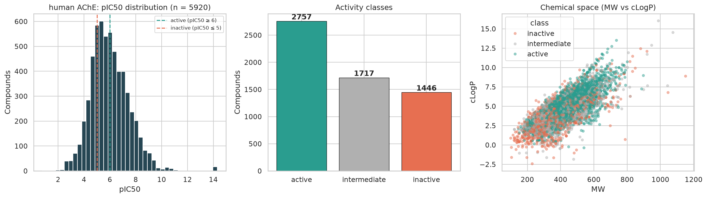
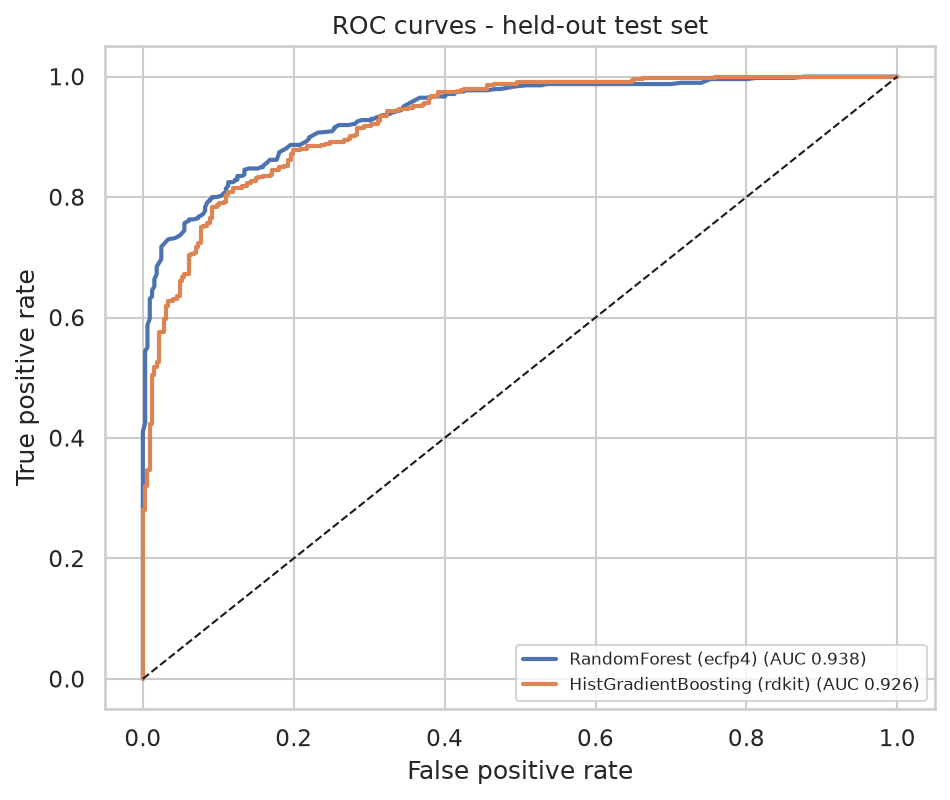
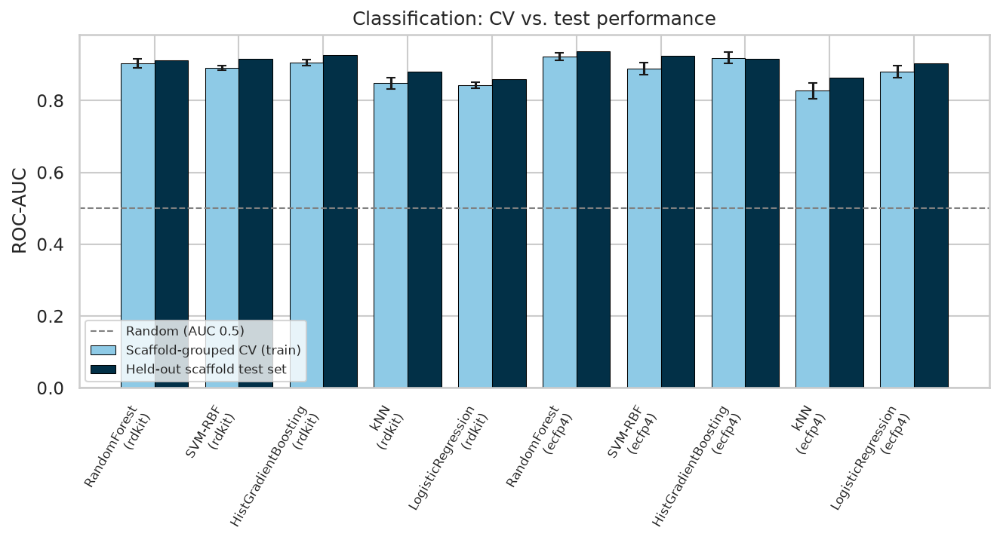
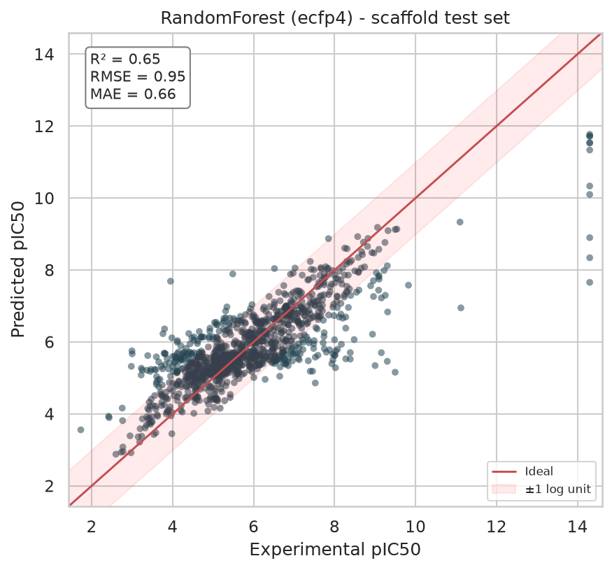
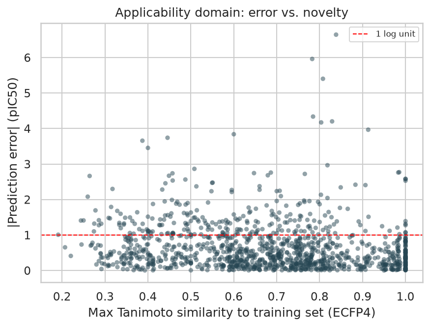
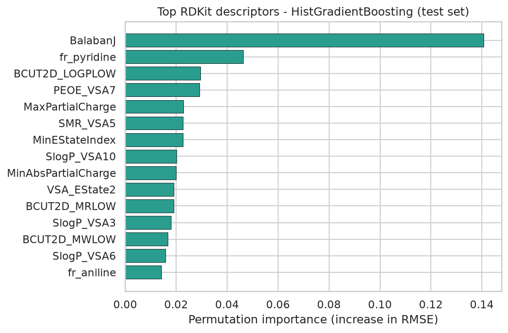

# QSAR Modelling of Acetylcholinesterase (AChE) Inhibitors

[](../../actions/workflows/ci.yml)


A reproducible machine-learning pipeline that predicts the potency of small molecules against **human acetylcholinesterase** (ChEMBL target [`CHEMBL220`](https://www.ebi.ac.uk/chembl/target_report_card/CHEMBL220/)), a validated drug target in Alzheimer's disease. Starting from public ChEMBL bioactivity data it curates a dataset, trains and tunes classification and regression models, and validates them with a **scaffold split**, **bootstrap confidence intervals**, **y-randomisation** and an **applicability-domain analysis**.

> **Note on target IDs.** `CHEMBL220` is human AChE. `CHEMBL216`, which is easy to confuse with it, is the muscarinic M1 receptor.

## Results

<!-- RESULTS:START -->
_Auto-generated by `run_pipeline.py` on 2026-11-10 · unknown · seed 42 · RDKit 2026.09.1 · scikit-learn 1.9.1_

### Dataset

| Curation step | Count |
|---|---|
| Raw IC50 records downloaded | 10079 |
| After exact-value / nM / biochemical-assay filter | 7646 |
| After structure standardisation | 7643 |
| Unique parent compounds | 6021 |
| **Final curated compounds** (replicate SD ≤ 1 log unit) | **5920** |
| Active / intermediate / inactive | 2757 / 1717 / 1446 |



### Validation protocol

- **Scaffold split**: 4736 train / 1184 test compounds; 0 Bemis-Murcko scaffolds shared between the two sets.
- Hyper-parameters tuned by **5-fold scaffold-grouped cross-validation on the training set only**; the best model is chosen by CV score, and the test set is used once for reporting.
- Imputation, variance filtering and scaling are fitted inside each CV fold (sklearn `Pipeline`).

### Classification: active (IC50 ≤ 1 µM) vs inactive (IC50 ≥ 10 µM)

| Model | Features | CV ROC-AUC | Test ROC-AUC | Balanced acc. | MCC |
|---|---|---|---|---|---|
| ★ RandomForest | ecfp4 | 0.923 ± 0.011 | 0.938 | 0.852 | 0.694 |
| HistGradientBoosting | ecfp4 | 0.919 ± 0.015 | 0.916 | 0.848 | 0.699 |
| HistGradientBoosting | rdkit | 0.906 ± 0.008 | 0.926 | 0.820 | 0.651 |
| RandomForest | rdkit | 0.904 ± 0.013 | 0.912 | 0.790 | 0.585 |
| SVM-RBF | rdkit | 0.891 ± 0.007 | 0.916 | 0.804 | 0.640 |
| SVM-RBF | ecfp4 | 0.889 ± 0.016 | 0.924 | 0.791 | 0.623 |
| LogisticRegression | ecfp4 | 0.880 ± 0.016 | 0.903 | 0.811 | 0.623 |
| kNN | rdkit | 0.848 ± 0.015 | 0.881 | 0.753 | 0.563 |
| LogisticRegression | rdkit | 0.843 ± 0.008 | 0.860 | 0.780 | 0.554 |
| kNN | ecfp4 | 0.827 ± 0.023 | 0.863 | 0.669 | 0.448 |
| Baseline (prior/mean) | - | - | 0.500 | 0.500 | 0.000 |

★ = model selected by cross-validation.





### Regression: pIC50 prediction (all compounds)

| Model | Features | CV RMSE | Test R² | Test RMSE | Test MAE | Pearson r |
|---|---|---|---|---|---|---|
| ★ RandomForest | ecfp4 | 0.957 ± 0.120 | 0.652 | 0.947 | 0.660 | 0.818 |
| HistGradientBoosting | ecfp4 | 0.959 ± 0.095 | 0.635 | 0.970 | 0.716 | 0.798 |
| HistGradientBoosting | rdkit | 1.012 ± 0.093 | 0.560 | 1.064 | 0.735 | 0.753 |
| RandomForest | rdkit | 1.030 ± 0.096 | 0.520 | 1.112 | 0.767 | 0.738 |
| SVR-RBF | rdkit | 1.031 ± 0.087 | 0.487 | 1.150 | 0.765 | 0.698 |
| SVR-RBF | ecfp4 | 1.061 ± 0.096 | 0.528 | 1.103 | 0.781 | 0.744 |
| kNN | rdkit | 1.107 ± 0.094 | 0.486 | 1.151 | 0.822 | 0.704 |
| Ridge | ecfp4 | 1.131 ± 0.101 | 0.415 | 1.228 | 0.872 | 0.668 |
| kNN | ecfp4 | 1.156 ± 0.088 | 0.437 | 1.204 | 0.902 | 0.691 |
| Ridge | rdkit | 1.205 ± 0.085 | 0.293 | 1.350 | 0.988 | 0.543 |
| Baseline (prior/mean) | - | - | -0.012 | 1.615 | 1.226 | - |



### Selected models (held-out test set, bootstrap 95% CI)

- **Classification**: RandomForest on `ecfp4` features: ROC-AUC 0.938 (95% CI 0.922-0.951); balanced accuracy 0.852 (95% CI 0.828-0.876); MCC 0.694 (95% CI 0.646-0.741)
- **Regression**: RandomForest on `ecfp4` features: R² 0.652 (95% CI 0.603-0.690); RMSE 0.947 (95% CI 0.876-1.029); MAE 0.660 (95% CI 0.622-0.701)

### Robustness checks

- **Y-randomisation (classification)**: real ROC-AUC = 0.938 vs. 0.488 mean / 0.545 max over 20 label-shuffled models.
- **Y-randomisation (regression)**: real R2 = 0.652 vs. -0.132 mean / -0.048 max over 20 label-shuffled models.

**Applicability domain** - test-set RMSE binned by each compound's maximum Tanimoto similarity to the training set:

| Max Tanimoto to training set | Test compounds | RMSE |
|---|---|---|
| <0.4 | 130 | 0.93 |
| 0.4-0.6 | 277 | 1.04 |
| 0.6-0.8 | 448 | 0.89 |
| ≥0.8 | 329 | 0.95 |



**Most influential RDKit descriptors** (HistGradientBoosting, permutation importance): `BalabanJ`, `fr_pyridine`, `BCUT2D_LOGPLOW`, `PEOE_VSA7`, `MaxPartialCharge`, `SMR_VSA5`, `MinEStateIndex`, `SlogP_VSA10`, `MinAbsPartialCharge`, `VSA_EState2`.


<!-- RESULTS:END -->

## Pipeline

```
ChEMBL REST API ─► curation ─► features ─► scaffold split ─► tuning (grouped CV) ─► held-out test ─► validation
 (IC50, CHEMBL220)  standardise   RDKit 2D     train / test      5 model families      reported once     y-randomisation,
                    dedupe        descriptors   share no          × 2 feature sets                        bootstrap CIs,
                    pIC50         + ECFP4       scaffolds                                                 applicability domain
```

## Quick start

```bash
git clone https://github.com/<your-username>/ache-qsar-chembl220.git
cd ache-qsar-chembl220
python -m venv .venv && source .venv/bin/activate      # Windows: .venv\Scripts\activate
pip install -r requirements.txt

python run_pipeline.py                 # downloads data, trains, validates, writes results/ and updates this README
python -m pytest -q                    # unit tests
```

Score your own molecules with the trained models:

```bash
python -m ache_qsar.predict --smiles "COc1cc2c(cc1OC)C(=O)C(CC1CCN(Cc3ccccc3)CC1)C2"
```

Useful options: `--features rdkit,ecfp4,combined` · `--split scaffold|random` · `--input-csv my_raw_data.csv` · `--fast` (small grids; smoke test only). Run `python run_pipeline.py --help` for all of them. The full run tunes ~10 models per task and feature set, so allow some time on a laptop; use `--n-jobs` to control parallelism.

The step-by-step narrative lives in [`notebooks/01_ache_qsar_walkthrough.ipynb`](notebooks/01_ache_qsar_walkthrough.ipynb).

## Repository structure

```
ache_qsar/            library code
  config.py             thresholds and settings in one place
  data.py               ChEMBL download, structure standardisation, curation
  features.py           RDKit descriptors, Morgan count fingerprints, similarity
  split.py              scaffold / random splits
  models.py             model zoo + hyper-parameter grids (sklearn Pipelines)
  evaluate.py           metrics and bootstrap confidence intervals
  plots.py              figures
  pipeline.py           end-to-end orchestration and report generation
  predict.py            score new molecules
run_pipeline.py       command-line entry point
notebooks/            walkthrough notebook
tests/                pytest unit tests (run in CI)
data/raw/             cached ChEMBL snapshot (+ release number)
data/processed/       curated dataset
results/              metrics tables, figures, RESULTS.md, run_info.json
```

## Methodology

| Decision | Rationale |
|---|---|
| Exact (`=`) IC₅₀ values in nM from biochemical assays only | Censored values (`>`, `<`) and cell-based readouts are not comparable potencies |
| Structures reduced to the neutral parent compound; replicate measurements merged to the **median pIC₅₀**; compounds with replicate SD > 1 log unit removed | Prevents the same molecule appearing in both train and test, and limits assay noise |
| Active: pIC₅₀ ≥ 6 (≤ 1 µM) · inactive: pIC₅₀ ≤ 5 (≥ 10 µM) · intermediate compounds used for regression only | Clear class boundary; regression uses all of the data |
| **Bemis–Murcko scaffold split** and **scaffold-grouped CV** | Measures generalisation to new chemotypes; random splits are optimistic for congeneric series |
| Preprocessing inside sklearn `Pipeline`s | No information leaks from validation or test data into imputation, filtering or scaling |
| Model selected by **cross-validation only**; test set used once | Avoids selecting the "best" model on the test set |
| Metrics beyond accuracy: ROC-AUC, balanced accuracy, MCC (classification); R², RMSE, MAE, Pearson r (regression) | Classes are imbalanced; accuracy alone is misleading |
| Trivial baseline, bootstrap 95% CIs, y-randomisation, applicability-domain analysis | Shows the models learn real structure–activity signal and where they can be trusted |

## Limitations

* ChEMBL IC₅₀ values are pooled from many laboratories and assay formats, which caps the achievable accuracy.
* Predictions for molecules structurally far from the training data are extrapolations (see the applicability-domain analysis).
* Performance is retrospective (held-out ChEMBL compounds); no prospective experimental validation was performed.
* Possible extensions: graph neural networks (Chemprop), 3D/conformer descriptors, conformal prediction, docking-based rescoring.

## Data and licence

Bioactivity data come from [ChEMBL](https://www.ebi.ac.uk/chembl/) (CC BY-SA 3.0); the release used is recorded in `results/run_info.json`. Code is released under the MIT licence (see `LICENSE`).

## References

* Zdrazil B. et al. The ChEMBL Database in 2023. *Nucleic Acids Res.* 2024, 52(D1), D1180-D1192.
* RDKit: open-source cheminformatics, <https://www.rdkit.org>.
* Pedregosa F. et al. Scikit-learn: machine learning in Python. *J. Mach. Learn. Res.* 2011, 12, 2825-2830.
