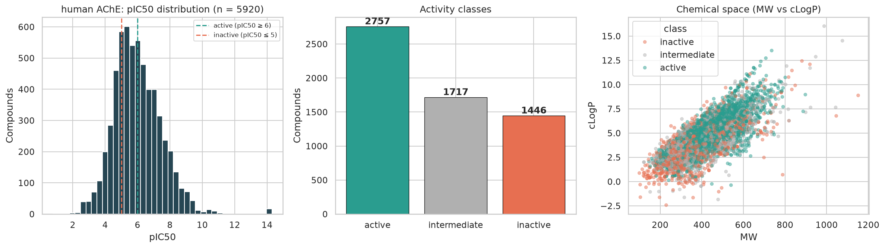
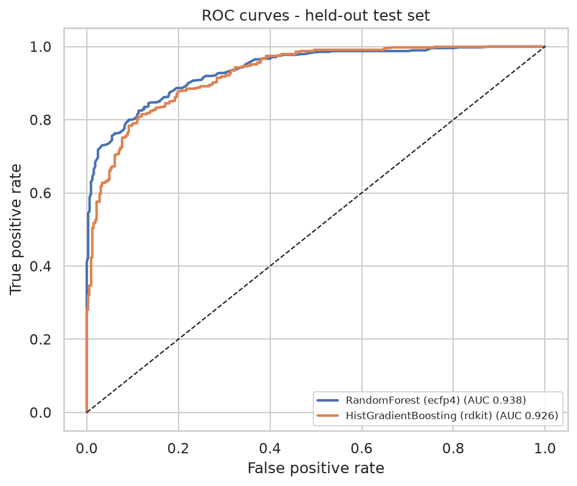
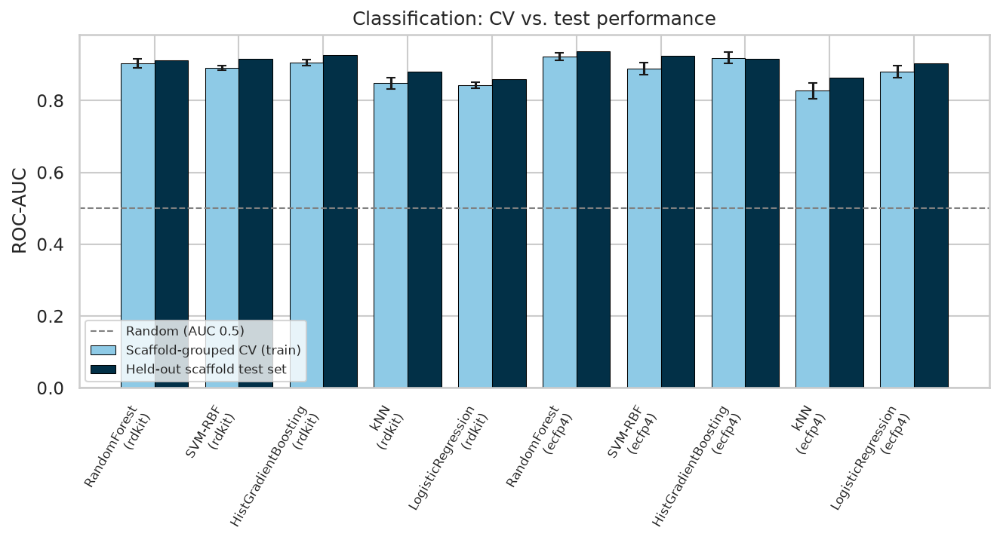
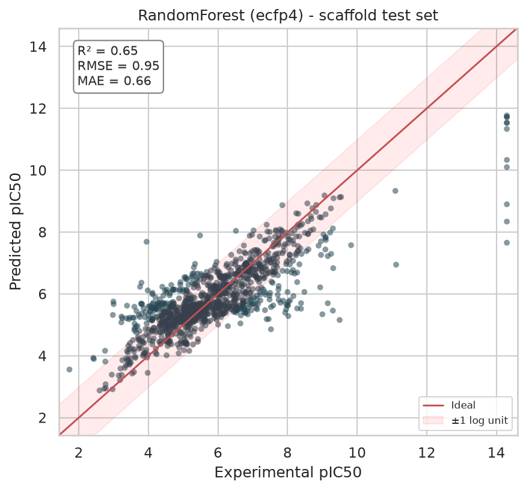
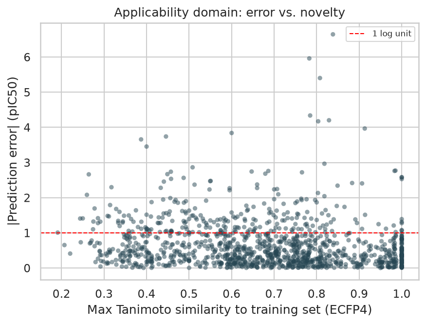
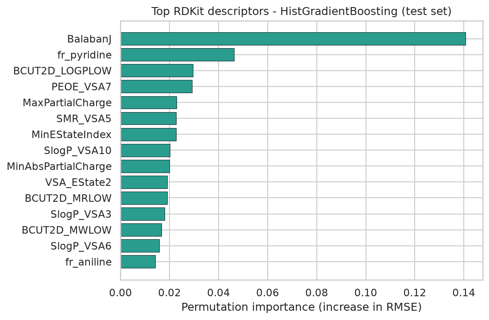

_Auto-generated by `run_pipeline.py` on 2026-11-10 · unknown · seed 42 · RDKit 2026.09.1 · scikit-learn 1.9.1_

### Dataset

| Curation step | Count |
|---|---|
| Raw IC50 records downloaded | 10079 |
| After exact-value / nM / biochemical-assay filter | 7646 |
| After structure standardisation | 7643 |
| Unique parent compounds | 6021 |
| **Final curated compounds** (replicate SD ≤ 1 log unit) | **5920** |
| Active / intermediate / inactive | 2757 / 1717 / 1446 |

### Validation protocol

- **Scaffold split**: 4736 train / 1184 test compounds; 0 Bemis-Murcko scaffolds shared between the two sets.
- Hyper-parameters tuned by **5-fold scaffold-grouped cross-validation on the training set only**; the best model is chosen by CV score, and the test set is used once for reporting.
- Imputation, variance filtering and scaling are fitted inside each CV fold (sklearn `Pipeline`).

### Classification: active (IC50 ≤ 1 µM) vs inactive (IC50 ≥ 10 µM)

| Model | Features | CV ROC-AUC | Test ROC-AUC | Balanced acc. | MCC |
|---|---|---|---|---|---|
| ★ RandomForest | ecfp4 | 0.923 ± 0.011 | 0.938 | 0.852 | 0.694 |
| HistGradientBoosting | ecfp4 | 0.919 ± 0.015 | 0.916 | 0.848 | 0.699 |
| HistGradientBoosting | rdkit | 0.906 ± 0.008 | 0.926 | 0.820 | 0.651 |
| RandomForest | rdkit | 0.904 ± 0.013 | 0.912 | 0.790 | 0.585 |
| SVM-RBF | rdkit | 0.891 ± 0.007 | 0.916 | 0.804 | 0.640 |
| SVM-RBF | ecfp4 | 0.889 ± 0.016 | 0.924 | 0.791 | 0.623 |
| LogisticRegression | ecfp4 | 0.880 ± 0.016 | 0.903 | 0.811 | 0.623 |
| kNN | rdkit | 0.848 ± 0.015 | 0.881 | 0.753 | 0.563 |
| LogisticRegression | rdkit | 0.843 ± 0.008 | 0.860 | 0.780 | 0.554 |
| kNN | ecfp4 | 0.827 ± 0.023 | 0.863 | 0.669 | 0.448 |
| Baseline (prior/mean) | - | - | 0.500 | 0.500 | 0.000 |

★ = model selected by cross-validation.

### Regression: pIC50 prediction (all compounds)

| Model | Features | CV RMSE | Test R² | Test RMSE | Test MAE | Pearson r |
|---|---|---|---|---|---|---|
| ★ RandomForest | ecfp4 | 0.957 ± 0.120 | 0.652 | 0.947 | 0.660 | 0.818 |
| HistGradientBoosting | ecfp4 | 0.959 ± 0.095 | 0.635 | 0.970 | 0.716 | 0.798 |
| HistGradientBoosting | rdkit | 1.012 ± 0.093 | 0.560 | 1.064 | 0.735 | 0.753 |
| RandomForest | rdkit | 1.030 ± 0.096 | 0.520 | 1.112 | 0.767 | 0.738 |
| SVR-RBF | rdkit | 1.031 ± 0.087 | 0.487 | 1.150 | 0.765 | 0.698 |
| SVR-RBF | ecfp4 | 1.061 ± 0.096 | 0.528 | 1.103 | 0.781 | 0.744 |
| kNN | rdkit | 1.107 ± 0.094 | 0.486 | 1.151 | 0.822 | 0.704 |
| Ridge | ecfp4 | 1.131 ± 0.101 | 0.415 | 1.228 | 0.872 | 0.668 |
| kNN | ecfp4 | 1.156 ± 0.088 | 0.437 | 1.204 | 0.902 | 0.691 |
| Ridge | rdkit | 1.205 ± 0.085 | 0.293 | 1.350 | 0.988 | 0.543 |
| Baseline (prior/mean) | - | - | -0.012 | 1.615 | 1.226 | - |

### Selected models (held-out test set, bootstrap 95% CI)

- **Classification**: RandomForest on `ecfp4` features: ROC-AUC 0.938 (95% CI 0.922-0.951); balanced accuracy 0.852 (95% CI 0.828-0.876); MCC 0.694 (95% CI 0.646-0.741)
- **Regression**: RandomForest on `ecfp4` features: R² 0.652 (95% CI 0.603-0.690); RMSE 0.947 (95% CI 0.876-1.029); MAE 0.660 (95% CI 0.622-0.701)

### Robustness checks

- **Y-randomisation (classification)**: real ROC-AUC = 0.938 vs. 0.488 mean / 0.545 max over 20 label-shuffled models.
- **Y-randomisation (regression)**: real R2 = 0.652 vs. -0.132 mean / -0.048 max over 20 label-shuffled models.

**Applicability domain** - test-set RMSE binned by each compound's maximum Tanimoto similarity to the training set:

| Max Tanimoto to training set | Test compounds | RMSE |
|---|---|---|
| <0.4 | 130 | 0.93 |
| 0.4-0.6 | 277 | 1.04 |
| 0.6-0.8 | 448 | 0.89 |
| ≥0.8 | 329 | 0.95 |

**Most influential RDKit descriptors** (HistGradientBoosting, permutation importance): `BalabanJ`, `fr_pyridine`, `BCUT2D_LOGPLOW`, `PEOE_VSA7`, `MaxPartialCharge`, `SMR_VSA5`, `MinEStateIndex`, `SlogP_VSA10`, `MinAbsPartialCharge`, `VSA_EState2`.

